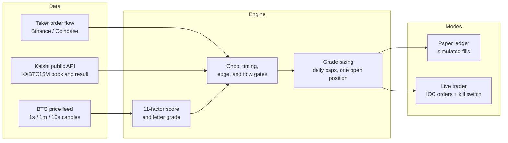

# Kalshi BTC 15-Minute Trading Bot

A Python bot for Kalshi's `KXBTC15M` 15-minute Bitcoin up/down markets. Each window it scores a direction from short-horizon price factors, applies chop and order-flow filters, and can buy YES or NO when the model's edge clears a fee-aware threshold. A paper ledger runs by default. Live trading is optional and is **disabled in the config shipped here**.

The repository also includes a separate Polymarket paper bot (`bot.py` / `config.json`) for the same 15-minute BTC idea, with live execution left as a disabled stub.

This is a cleaned, shareable snapshot (source, tests, and config templates only). It does not include account data, logs, or credentials.

## Architecture



- `btcbot/kengine.py` — main Kalshi loop: windows, gates, paper exits, heartbeat.
- `btcbot/factors.py` and `btcbot/kexecutor.py` — scoring, timing, and paper fills.
- `btcbot/orderflow.py` — taker-delta gate (blocks entries against heavy opposing flow).
- `btcbot/kauth.py` and `btcbot/live.py` — RSA-PSS / Ed25519 signed requests and the live order manager.
- `btcbot/kalshi.py` — public market helpers and the quadratic taker-fee formula.
- `bot.py` / `btcbot/engine.py` — optional Polymarket paper bot.

## Key features

- **Signed Kalshi requests.** Live calls sign `timestamp + METHOD + path` with RSA-PSS (SHA-256) or Ed25519. Credentials come from the environment only and are never printed, logged, or written to disk.
- **IOC limit orders with idempotent client order IDs.** Entry and exit orders use deterministic `client_order_id`s. POST is single-shot; startup reconciliation books fills that landed after a crash.
- **Fee-aware edge.** Entries require model probability minus price minus the Kalshi taker fee (`ceil(0.07 · C · P · (1 − P))`) to clear a minimum edge. A tighter 5¢ edge applies in the 0.60–0.70 price band.
- **Risk limits.** Hard caps in code (config can only tighten them): grade-based size (B $10 / A $15 / A+ $20, max $20), one open position, 50 live trades per day, a $100 daily loss cap with stake step-down, a kill-switch file, and a cancel-before-close window.
- **Paper simulation.** The same entry and exit rules run against a local ledger so you can test changes without an API key.
- **Tests.** Offline rule, sizing, exit, and fake-exchange tests. No credentials or network required.

## Signal and exits (defaults in `config_kalshi.json`)

The score combines a moving-average ribbon, 15-minute context, 1-minute momentum, a 10-second trigger, volume, order-flow imbalance, range location, and RSI. A chop filter skips mixed or low-efficiency tapes. Timing: any passing grade from t+120s to t+240s; later entries need score ≥ 7 and at least six minutes left; nothing after t+540s.

Exits (first trigger wins): a 0.92 bid ceiling, a net +15% take-profit on all-in entry cost, a true breakeven (after fees) with ≤ 180 seconds left, or a +0.20 price take-profit. There is no stop-loss; losers can ride to settlement, so the stake is the maximum loss on that trade.

## Setup

```bash
cd btc-kalshi-bot
python3 -m venv .venv && source .venv/bin/activate
pip install -r requirements.txt          # cryptography (Python 3.11+)
```

Paper mode and the unit tests need no API keys. Live trading also needs:

| Variable | Needed for | Notes |
|---|---|---|
| `KALSHI_API_KEY_ID` | live only | Create an API key in the Kalshi account settings. |
| `KALSHI_PRIVATE_KEY` | live only | PEM contents. Export them in your shell (`set -a && source .env && set +a`); this bot does not auto-load `.env`. |

Copy `.env.example` to `.env` and fill in dummy-to-real values only if you enable live mode. Never commit `.env` or a real private key.

## Run in paper mode

`config_kalshi.json` ships with `"paper": true` and `"live": { "enabled": false, "dry_run": true }`. These commands do not place real orders:

```bash
python3 -m unittest discover -s tests    # offline tests, no credentials
python3 kalshi_bot.py status             # paper (and live, if any) ledger summary
python3 kalshi_bot.py run                # Kalshi paper loop
./start.sh                               # optional supervisor for the Polymarket paper bot
python3 bot.py status                    # Polymarket paper bot status
```

`./start_kalshi.sh` starts the Kalshi supervisor and is intended for live use; it will refuse to start if credentials are not in the environment. Leave `live.enabled` false unless you mean to trade real money.

## Live trading (opt-in, real money)

1. Put Kalshi credentials in the environment (not in git).
2. Set `live.enabled` to `true` in `config_kalshi.json`. Keep `dry_run` true until you have watched the paper ledger.
3. Start with `./start_kalshi.sh`. Stop new orders immediately with `./stop_kalshi.sh` (writes a `KILL` file, then stops the process).

Live orders are immediate-or-cancel limits. The bot cancels resting orders in the last minute of a window, reconciles exchange positions on startup, and will not size a trade that would breach the daily loss cap. Prediction-market trading is risky; you can lose the money you put in.

## Tech stack

- Python 3.11+
- `cryptography` for RSA-PSS / Ed25519 request signing
- Kalshi Trade API v2 for markets and (optional) signed orders
- Public BTC price and taker-flow sources (Binance Vision / Coinbase) for signals
- `unittest` for the offline test suite

## Disclaimer

This is an educational / portfolio project, not financial advice and not a promise of profit. Paper results do not predict live results. Short-horizon crypto markets are noisy; fees, latency, and stale data can wipe out a small edge. Use at your own risk, and never commit real API keys or private keys to git.
